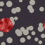
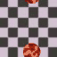
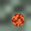
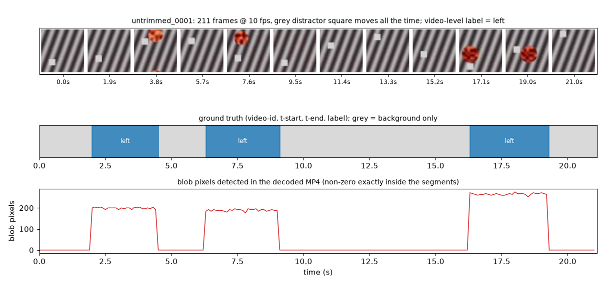
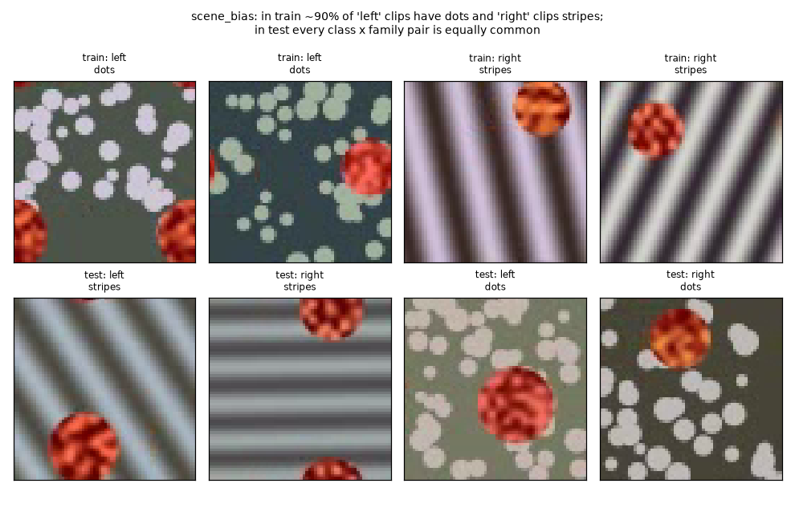

# Phase 2 benchmarks: motion, untrimmed and scene-bias

The Phase 2 benchmarks are synthetic video datasets with exactly known ground truth. Each one
checks one claim:

- **direction, speed, periodic** check that a model *learns motion*. On these tasks the
  rendered single frame is class-independent by construction (torus world, centred
  trajectories). Linear pixel probes confirm it on the encoded clips for all three tasks, and a frozen
  `single_frame:resnet18` does on direction only. A fine-tuned `single_frame:resnet18` also stays at chance on all three, with and without codec artefacts (one seed; see "Is the data honest?").
- **untrimmed** checks that a model can *find where an action is* when it is trained only on
  video-level labels. Phase 4 (timeline, CtxPL localisation) uses it.
- **scene_bias** checks that a model *ignores the background*. Phases 4 and 6 use it to measure
  background reliance.

The code is in `benchmarks/`. Every task uses the same world: a textured red disc (the *blob*)
moves over a static textured background, and the world wraps around like a torus. When the blob
leaves on the right it comes back on the left. Because of the wrap, the blob's position in any
single frame is uniform, whatever its velocity.

## Generate

```powershell
.venv\Scripts\python.exe -m benchmarks.synthetic_motion --task direction  --out .artifacts\bench\direction
.venv\Scripts\python.exe -m benchmarks.synthetic_motion --task speed      --out .artifacts\bench\speed
.venv\Scripts\python.exe -m benchmarks.synthetic_motion --task periodic   --out .artifacts\bench\periodic
.venv\Scripts\python.exe -m benchmarks.synthetic_motion --task untrimmed  --out .artifacts\bench\untrimmed
.venv\Scripts\python.exe -m benchmarks.synthetic_motion --task scene_bias --out .artifacts\bench\scene_bias
```

| Option | Default | Notes |
|---|---|---|
| `--seed` | 0 | Same arguments and seed give the same pixels. Each clip has its own generator seeded by `(seed, task, split, index)`, so a clip does not depend on how many other clips you generate. |
| `--size` | 64 (untrimmed 48) | Frame side in pixels. Must be even. Speeds are given for 32 px and scale with the size. |
| `--num_frames` | 12 (periodic 16) | Length of a trimmed clip. |
| `--n_train` / `--n_test` | 700 / 400 | Same as the course slide's experiment. |
| `--n_val` | 200 | Validation split (disjoint scenes) for direction, speed, periodic and scene_bias. For scene_bias it is the biased held-out split. Model runs validate on it, never on test. |
| `--bias` | 0.9 | scene_bias only. |
| `--n_videos`, `--min_length`, `--max_length`, `--max_instances`, `--n_classes`, `--background_motion` | 40, 150, 300, 3, 3, mixed | untrimmed only. |
| `--fps` | 10 | Stored in the metadata. Segment times are `frame / fps`. |
| `--codec` | auto | `auto` uses H.264 (`avc1`) if the OpenCV build can encode it, otherwise MPEG-4 Part 2 (`mp4v`). Both carry motion vectors. The pip OpenCV wheel on Windows has no OpenH264 DLL, so you get `mp4v` there. The codec used is recorded in `dataset.json`. |

Generating is fast. 500 clips at 32×32 with 12 frames take about 1.5 s. Twelve untrimmed videos
of about 200 frames at 48×48 take about 0.3 s.

## The five tasks

### direction (the course slide's experiment)
 
&nbsp; `left` and `right`.

There are two classes, and they differ **only in the sign of the horizontal velocity** `vx`:

- The speed `|vx|` is drawn from U(1, 2) px/frame at 32 px.
- A small vertical drift `vy` ~ U(−0.25, 0.25)·|vx| does not depend on the class.
- The trajectory is centred on the middle frame: `x_t = x_mid + vx·(t − (T−1)/2)`. The set of
  positions is therefore the same for `+vx` and `−vx`, which makes the **frame average identical
  for both classes**.
- The blob is drawn with sub-pixel bilinear sampling and its texture moves rigidly with it.

Clips are grouped into *scenes*. A scene is one background instance and is recorded in the
`group` column. Each scene holds one clip of each class, so the background carries no class
information. Train and test scenes are disjoint.

`hflip_safe: false`, because a horizontal flip swaps the label.

### speed (regression, `mode=reg`)
  &nbsp; slow and fast.

The scene is the same as in direction, with a random sign. The label (`labels`, a float) is the
speed `|vx|` in px/frame, drawn from U(0.5, 3) at 32 px.

### periodic
  &nbsp; `drift` and `oscillate`.

- `drift` moves at a constant ±m.
- `oscillate` follows `x = x_mid + A·sin(2π f t + φ)` for 1–2 cycles per clip, with a random
  phase.
- Both classes have the **same mean absolute speed** m. The amplitude is A = m / (4f).

Flips are safe for this task.

### untrimmed (weakly-supervised localisation oracle)


- Each video is long: 150–300 frames by default, at 10 fps.
- Each video contains 1–`max_instances` action instances. Their classes are motion patterns:
  `right`, `left`, `oscillate`, `up`, `down`, `circle` (the first `n_classes`, sorted).
- Every instance is separated from the next by at least `min_gap` = 8 background-only frames, and
  the video starts and ends with background as well.
- **The blob is visible exactly inside a segment.** Frame `f` shows the blob if and only if
  `start_frame ≤ f < end_frame` for some segment, so `t_start = start_frame / fps` and
  `t_end = end_frame / fps` (the end is exclusive).
- Background motion is chosen per video when `mixed`:
  - `static`: nothing moves outside actions.
  - `distractor`: a grey square bounces vertically through the whole video. It is motion, but it
    is not an action.
- The only label a weakly-supervised model may train on is the **video-level multi-hot** label.
  It appears in the manifest columns `label_<class>` and `labels` (`;`-joined class names), and
  in `dataset.json` as `multi_hot`.

### scene_bias (background reliance, after Choi et al., NeurIPS 2019)


- The classes are motion directions (`right`, `left`, plus `down` and `up` for 3–4 classes).
- Each class is paired with a background texture family. The families are `stripes`, `dots`,
  `checker` and `noise`.
- In `train` and in the biased held-out `val`, a clip gets its class's family with probability
  `bias` (default 0.9).
- In `test`, every class × family combination occurs equally often. The family is independent of
  the class there.
- Motion stays a perfectly reliable cue on every split.

Every clip has its own background, so `group` = clip.

## Output format

```
out/
  videos/<video_id>.mp4
  manifest.csv          every clip
  train.csv, test.csv   one split each (+ val.csv for scene_bias); same columns as manifest.csv
  dataset.json          metadata + per-video ground truth
  masks.npz             blob masks per video: np.packbits(bool[T, H, W]); shape in dataset.json
  gt_segments.csv       untrimmed only: video-id, t-start, t-end, label   (ActivityNet / CtxPL eval style)
  gt_activitynet.json   untrimmed only: {"taxonomy": [...], "database": {vid: {"subset", "duration",
                        "fps", "num_frames", "annotations": [{"segment": [t0, t1], "label"}]}}}
```

### Manifest columns

These columns feed `handlers/video_manifest.py` (`read_video_manifest` / `load_video_manifest`)
and `ParquetVideoDataset` unchanged:

| Column | Tasks | Meaning |
|---|---|---|
| `videos` | all | Path relative to the CSV (`videos/<id>.mp4`). |
| `labels` | all | Class name (direction/periodic/scene_bias), speed as a float (speed), or the `;`-joined classes present (untrimmed). |
| `label_idx` | classification tasks | Index into the sorted `classes`. This is the same order DeepTune's `LabelEncoder` produces. |
| `group` | all | Scene id (direction/speed/periodic: two clips per scene), the clip id (scene_bias), or the video id (untrimmed). Use it with `--grouper group`. |
| `split` | all | `train` / `val` / `test`. |
| `video_id` | all | Key into `dataset.json` and `masks.npz`. |
| `background_family` | all | `stripes` / `dots` / `checker` / `noise`. |
| `family_matches_class` | scene_bias | Whether the clip follows the bias. |
| `label_<class>`, `num_frames`, `fps`, `duration_sec`, `background_motion` | untrimmed | Multi-hot video label and timing. |

### `dataset.json`

The top-level keys are `format_version`, `task`, `seed`, `params`, `codec`, `container`, `fps`,
`size`, `classes`, `hflip_safe`, `vflip_safe` and `videos`.

Each entry in `videos` has `file`, `split`, `group`, `num_frames`, `duration_sec` and
`mask_shape`, plus:

- `centers`: the blob centre for each frame. It is `null` where the blob is absent (untrimmed).
- direction, speed and scene_bias: `velocity` `[vx, vy]` in px/frame.
- periodic: `motion` (the drift velocity, or amplitude, frequency and phase) and `mean_speed`.
- scene_bias: `background_family` and `family_matches_class`.
- untrimmed: these extra fields.
  - `segments`: `label`, `label_idx`, `start_frame`, `end_frame` (exclusive), `t_start`, `t_end`,
    `radius` and `motion`.
  - `background_intervals`: `[start, end)` frame ranges with no action. They are the exact
    complement of the segments.
  - `background_motion`.
  - `distractor`: `x0`, `side`, `colour` and the `y` of each frame.
  - `multi_hot` and `labels`.

Load a mask with `benchmarks.synthetic_motion.load_blob_masks(root, video_id)`. It returns
`bool[T, H, W]`, where True marks a blob or action pixel and everything else is background.
Phase 6 uses it to compute saliency-in-mask, and Phase 4 uses it for CAS mass inside the
segments.

## Is the data honest? (the test oracle)

`tests/benchmarks/test_benchmark_honesty.py` fits simple scikit-learn probes from
`benchmarks/probes.py` on the train split and scores them on held-out clips. The thresholds were set, per the author
(A3), before the first full run of the probes. They were not fixed in advance of every result, and the probes and generator were
adjusted after failures: the speed statistic was gated on changing pixels (R² 0.33 → 0.80), the
blob got a high-contrast texture, a uint8 overflow in the codec motion-vector feature was fixed,
and the motion-vector probe moved from 32×32 to 48×48 (0.81 → 0.985). The thresholds themselves
were not changed. Chance-level checks use an accuracy of 0.60 or less, on at
least 200 balanced held-out clips (s.d. ≈ 0.035).

**Scope of the "no single-frame signal" result.** It is shown for *linear probes on raw pixels*
(and FFT texture features) on direction, speed and periodic, and for a *frozen*
`single_frame:resnet18` on direction only. One codec channel was also checked:
middle-frame sharpness versus speed gives Spearman |r| ≤ 0.01 (Critic, V-022).

**Fine-tuned adversary (GPU, 2026-10-30).** `scripts/check_single_frame_adversary.py` fine-tunes a
pretrained `single_frame:resnet18` at 64 px with 700 train / 200 val / 400 test clips, 5 epochs,
lr 1e-3, seed 0. The default codec here is `mp4v`. The lossless clips are FFV1, and each one was
decoded back and matched its source frames exactly.

| Task | Metric | Adversary, `mp4v` | Adversary, lossless | Positive control, `mp4v` / lossless |
|---|---|---|---|---|
| direction | test accuracy | 0.505 | 0.515 | `flow_probe` 0.9925 / 0.9675 |
| speed | test R² | −0.02 | −0.39 | `flow_probe` 0.874 / 0.828 |
| periodic | test accuracy | 0.500 | 0.510 | `r3d_18` 0.995 / 0.9725 |

The same adversary does learn when a frame carries signal: on `scene_bias` it reaches 0.875 on the
biased split and 0.5125 on the unbiased test split, so these chance scores are not a training
failure. Limits: one seed and 5 epochs. Training accuracy stayed near 51 %, so a much longer run
could still find a weak leak. With two clips per scene, the 400 test clips hold fewer independent
scenes, so the usual ±0.05 interval at n = 400 is a lower bound. `flow_probe` uses mean flow on
classification tasks and cannot separate periodic (0.5175 / 0.51), which is why `r3d_18` is the
control there. State the result as "no signal found by these probes and this adversary", not as a
proof that a single frame carries none.

`scripts/check_benchmark_honesty.py` prints the same numbers at any size. The table below shows
them at CI size (32×32, 12 frames, seed 0, `mp4v`; train 300 / test 200, speed and periodic
200 / 200, scene_bias 300 / 200 / 200).

| Probe | Result | Required |
|---|---|---|
| direction: mean horizontal Farneback flow per frame pair (11 numbers) → logistic regression | **1.000** | ≥ 0.95 |
| direction: first / middle / last frame pixels → logistic regression | 0.500 / 0.485 / 0.540 (train 1.0) | ≤ 0.60 |
| direction: frame average → logistic regression | 0.515 | ≤ 0.60 |
| direction: codec motion vectors (PyAV `+export_mvs`, 48×48) → logistic regression | **0.985** | ≥ 0.95 (skipped without PyAV) |
| speed: flow summary → ridge, R² | 0.805 | ≥ 0.7 |
| speed: middle frame → ridge, R² | −0.07 | ≤ 0.2 |
| periodic: flow summary → logistic regression | 1.000 | ≥ 0.9 |
| periodic: middle frame | 0.445 | ≤ 0.60 |
| scene_bias: background only (blob masked out, FFT texture features), biased `val` | **0.915** | ≥ 0.80 |
| scene_bias: the same probe, unbiased `test` | **0.520** | ≤ 0.60 |
| scene_bias: the same features → background family, unbiased `test` | 0.960 | ≥ 0.9 |
| scene_bias: flow → class on `val` / `test` | 1.000 / 1.000 | ≥ 0.95 |
| untrimmed: blob pixels in the decoded MP4 > 0 ⇔ frame inside a segment; mask IoU ≥ 0.6; multi-hot = set of segment labels | holds for every frame | exact |

**Codec motion vectors need room.** MPEG-4 predicts 16×16 macroblocks, so a 32×32 frame has
only four of them. At 32×32 the encoder codes most of the small blob as intra or skip blocks:
only about 37 % of frames carry a non-zero vector, and the MV probe reaches only 0.81. At 48×48
it reaches 0.985, and at 64×64 1.000. The MV probe therefore runs at 48×48. Phase 1 and Phase 3
should not use MV motion on clips smaller than about 48 px.

## Single-frame baseline and the benchmark runner

`--pooling single_frame` gives the Karpathy single-frame baseline: any 2D backbone (with or
without PEFT) sees only the middle frame (`src/video/single_frame.py`). It is built by
`utils.build_video_model`. Native 3D models reject it.

`scripts/run_motion_benchmark.py` trains a list of models through the existing manifest loader,
`ParquetVideoDataset` and the shared `Trainer`, then writes `results.csv`, `results.md` and
`results.json` (accuracy, ROC AUC, time and device):

```powershell
.venv\Scripts\python.exe scripts\run_motion_benchmark.py --task direction `
  --models flow_logreg single_frame:resnet18 mean:resnet18 attention:resnet18 r3d_18 `
  --n_train 700 --n_test 400 --size 64 --epochs 5
```

`--task scene_bias` reports `biased_val_*` and `unbiased_test_*` columns. `--task speed` is a
regression task (`mode=reg`) and reports `test_r2` and `test_mae`; its flow reference is the
flow summary fed to ridge regression (`flow_probe`, alias `flow_logreg`). `--hflip` adds a random
clip-level horizontal flip, and `benchmarks.guards.check_flip_augmentation` refuses it on
direction-labelled data (`direction`, `scene_bias`, `untrimmed`). Any future augmentation code
should call the same guard.

Regenerate the figures on this page with `python scripts/make_benchmark_figures.py`.

### First results (CPU, small; see `docs/video-plan/reports/A3-phase2-benchmarks.md`)

All runs used seed 0, 64×64 clips with 12 frames, and a 112 px input. **Frozen** means only the
head is trained (5 epochs, lr 1e-3, 300 train / 200 test clips).

**direction**

| Model | Test accuracy |
|---|---|
| flow_logreg | 1.000 |
| single_frame:resnet18 (frozen) | 0.52 |
| mean:resnet18 (frozen) | 0.51 |
| attention:resnet18 (frozen) | 0.505 |
| r3d_18 (frozen) | 0.505 |
| r3d_18, fully fine-tuned (200 / 200 clips, 3 epochs, lr 1e-4) | **1.000** |

**scene_bias**

| Model | Biased val | Unbiased test |
|---|---|---|
| single_frame:resnet18 (frozen) | 0.935 | 0.505 |
| flow_logreg | 0.995 | 0.995 |
